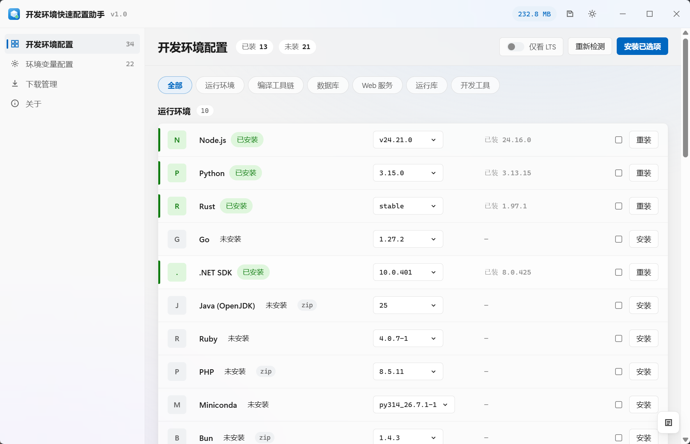
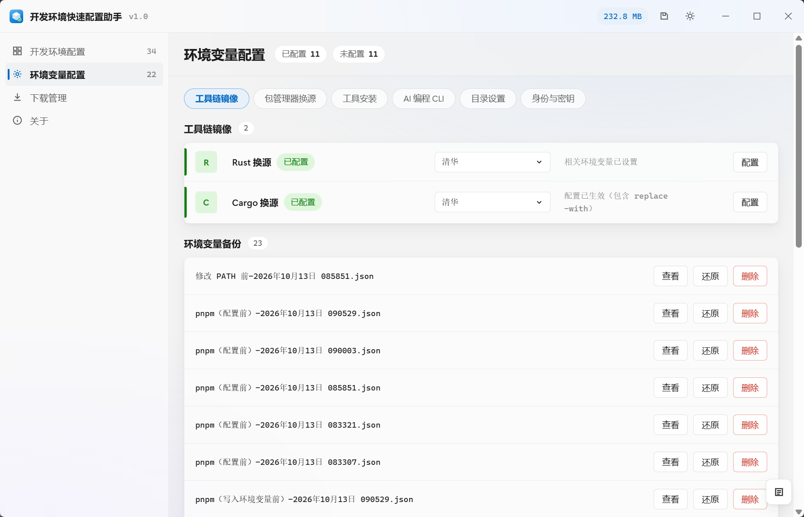

# 开发环境快速配置助手

一个面向 Windows 开发者的一站式环境组装工具：选好要装的软件，下载、安装引导、环境变量、镜像配置全部由工具自动完成。

基于 Tauri 2 + Svelte 构建，安装包体积小、不常驻后台。

> **不想一个个手动装环境？** 打开工具勾选要用的软件，点「安装已选」，剩下的版本选择、镜像回落、环境变量写入、换源全部自动搞定。

---

## 它能做什么

[](assets/home.png) [](assets/env.png)

左边：软件清单页，34 款工具按分类浏览，每行都能自己挑版本 ｜ 右边：环境变量配置页，换源、目录设置、Git 身份与 SSH 密钥都在这里

打开工具就是一份可勾选的软件清单：**已装的显示当前版本，没装的显示「未安装」，想重装的直接点「重装」**——所有条目共用同一套版本选择、下载、安装与检测逻辑，不会出现「两套东西」的感觉。

### 功能亮点

* **一键安装开发软件** —— 运行环境、编译工具链、数据库、Web 服务、运行库、IDE 共 34 款，选完点一下全部装好
* **版本自主选择** —— 从官方渠道拉取版本列表，默认选中最新稳定版，支持「仅看 LTS」过滤
* **国内镜像回落** —— 下载优先官网，失败自动回落国内镜像；镜像地址全部经过真实可用性验证，不会内置失效地址
* **下载缓存** —— 同一版本的安装包只下载一次，下载管理支持查看、单个删除与清空全部
* **环境变量安全写入** —— 写前自动备份、路径规范化去重（大小写、尾斜杠、变量引用）、写失败自动回滚、支持一键还原
* **包管理器换源** —— npm、pnpm、Yarn、pip、Conda、Cargo、Go、NuGet、RubyGems、Composer、Maven、Gradle、CRAN、Bun 一键换源，增量合并、重复执行不会写坏配置
* **安装状态真实检测** —— 以注册表卸载项为准，自定义安装盘符与目录也能正确识别
* **AI 编程 CLI** —— Claude Code CLI、Codex CLI 的一键安装入口
* **界面干净** —— 自定义标题栏、深浅色主题、无原生控件，开关一按即用

---

## 支持的软件（34 款）

| 分类   | 数量 | 软件                                                                  |
| ---- | -- | ------------------------------------------------------------------- |
| 运行环境 | 10 | Node.js / Python / Rust / Go / .NET SDK / Java (OpenJDK) / Ruby / PHP / Miniconda / Bun |
| 编译工具链 | 2  | Git / CMake（内置安装包）                                                   |
| 数据库  | 4  | MariaDB / MySQL / Redis / MongoDB                                    |
| Web 服务 | 2  | nginx / Apache HTTP Server                                           |
| 运行库  | 1  | VC++ 运行库 2015-2022                                                  |
| 开发工具 | 15 | Visual Studio 2022 / Visual Studio 2026 / Trae / CodeBuddy / WorkBuddy / Qoder / Cursor / Kiro / OpenCode / Claude Desktop / ZCode |

Trae、CodeBuddy、WorkBuddy、Qoder 均区分国内版与国际版，按需选择。

---

## 环境配置

[](assets/env.png)

工具链镜像、包管理器换源、目录设置、Git 身份与 SSH 密钥，改完即生效；下方是每次写入前自动保留下来的环境变量备份

* **工具链镜像** —— Rust（rustup 分发源）与 Cargo 换源，可切换清华等国内镜像
* **包管理器换源** —— 13 种主流包管理器一键切换镜像源，全部走官方命令行工具修改，不会手工解析配置文件出错
* **工具安装** —— pnpm、Yarn 等未被主清单收录的常用工具，在这里单独安装
* **AI 编程 CLI** —— Claude Code CLI、Codex CLI 一键安装
* **目录设置** —— npm 全局包目录与缓存目录，弹窗内选好一次保存
* **身份与密钥** —— Git 提交身份（用户名 / 邮箱）与 SSH 密钥；密钥生成采用 ed25519，检测到已有密钥时提示复用或改名新建，不会静默覆盖

### 环境变量备份

每次写入环境变量前自动备份原值，备份列表支持「查看」「还原」「删除」：

| 内容     | 位置                                            |
| ------ | --------------------------------------------- |
| 安装包缓存  | `%LOCALAPPDATA%\DevEnv\cache`                  |
| 环境变量备份 | `%LOCALAPPDATA%\DevEnv\env-backup`             |

运行日志只保存在本机，工具不会上传任何数据。

---

## 快速开始

### 系统要求

* Windows 10 / 11（x64）
* Node.js 20+
* Rust 1.77.2+（MSVC 工具链，含 Windows SDK）

### 从源码构建

```bash
git clone https://github.com/SaucePlum/DevEnv-Config.git
cd DevEnv-Config

npm install
npm run tauri dev      # 开发调试
npm run tauri build    # 产出安装包
```

打包产物为 NSIS 安装程序，默认每用户安装，位于 `src-tauri/target/release/bundle/nsis/`。

> **注意**：CMake 采用随工具打包的本地安装包 （`src-tauri/resources/payload/build/cmake/`）。该目录体积较大未纳入版本库，从源码构建前需要先把安装包放到对应路径，否则该条目会因缺少资源而无法安装。

### 代码结构

```
├── src/                  # 前端（Svelte 5 + TypeScript）
│   ├── views/            # 页面：软件总览、环境配置、下载管理、关于
│   └── lib/              # 组件与状态管理
└── src-tauri/            # 后端（Rust）
    ├── resources/manifest.toml   # 软件清单：所有条目、镜像与配置动作都在这里声明
    ├── src/provider/     # 版本源适配器：官方 API、目录列表、页面正则等十余种
    ├── src/config.rs     # 配置动作引擎：环境变量 / TOML / XML / 文件 / 命令 / SSH 密钥
    └── src/…             # 下载、安装、检测、环境变量、路径规范化等模块
```

新增软件或换源项只需修改 `manifest.toml`，必要时在 `provider/` 下补一个版本源适配器，无需改动界面代码。

---

## 常见问题

**Q：会收集我的数据吗？** 不会。所有下载缓存与环境变量备份都写在 `%LOCALAPPDATA%\DevEnv\` 下，日志只保存在本机，工具不联网上报任何信息。

**Q：为什么下载速度慢或失败？** 下载优先走官方网站，失败会自动回落国内镜像。官方源（GitHub 等）在部分网络环境下不稳定，工具已自动读取 Windows 系统代理配置，开启代理或 VPN 后再启动工具即可。

**Q：刚装完软件，再点配置为什么提示找不到命令？** 系统 PATH 刷新有延迟，工具会自动重载 PATH 并回退到绝对路径调用。若仍异常，重启工具或终端即可。

**Q：换源会覆盖我原来的配置吗？** 不会。换源采用增量合并，只修改对应字段，其余内容原样保留，重复执行也不会写坏配置。

**Q：环境变量改坏了怎么办？** 每次写入前都会自动备份原值。在「环境变量配置」页的备份列表里点「还原」，即可恢复到改动前的状态。

**Q：软件装在别的盘符也能识别吗？** 能。安装状态以注册表卸载项为准检测，不依赖默认安装路径，自定义盘符与目录都能正确识别。

**Q：缓存占空间怎么清理？** 打开「下载管理」，可以查看缓存文件列表、单个删除或一键清空。

---

## 参与贡献

欢迎提 Issue 与 Pull Request：

* 软件清单的地址失效、新软件支持请求
* 镜像源的可用性反馈（我们依赖真实用户的验证来维护清单）
* 界面与体验改进

---

## 相关链接

* 问题反馈：[Issues](https://github.com/SaucePlum/DevEnv-Config/issues)

---

## 协议

本项目基于 [MIT License](LICENSE) 开源。

## 作者

小念 —— 项目的开发者与维护者。
